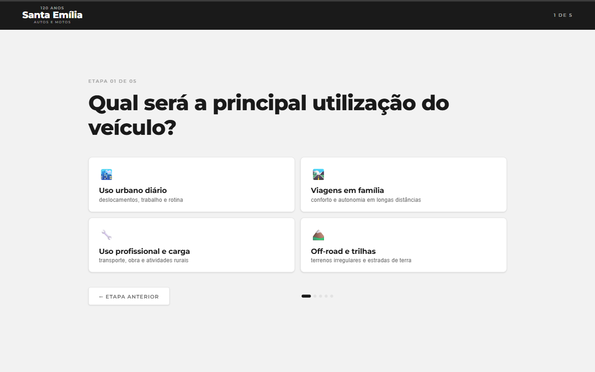
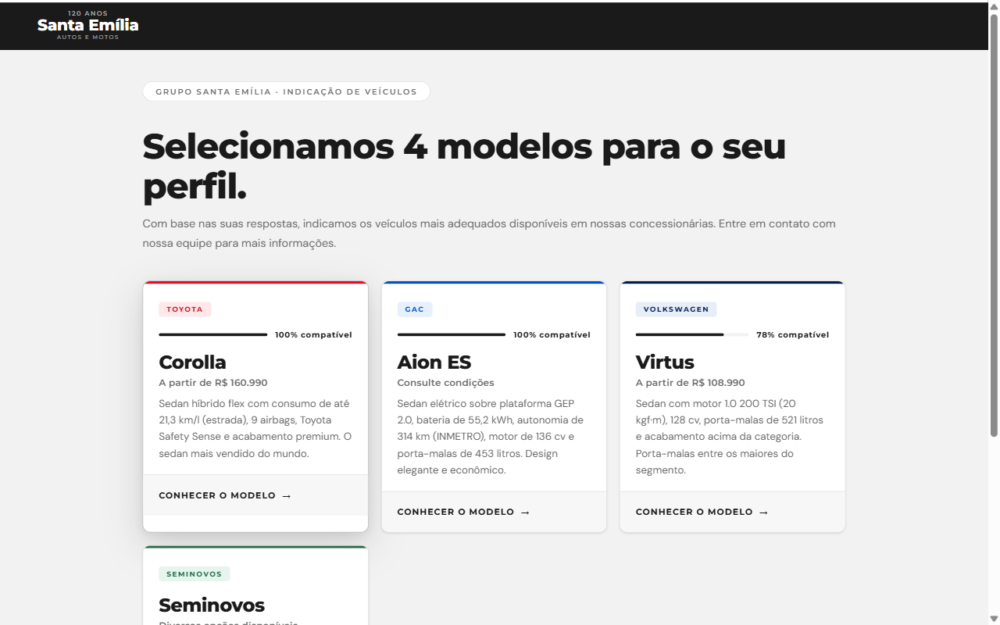

# Triagem de veículos: Santa Emília

Protótipo de uma ferramenta de indicação de carros para concessionárias, feito com os modelos do Grupo Santa Emília (Toyota, Volkswagen, Renault, GAC e seminovos). O cliente responde **5 perguntas** e recebe os modelos mais compatíveis com o perfil dele, cada um com o link direto para o estoque.

**No ar:** https://santa-emilia-triagem.vercel.app

| Pergunta | Resultado |
|---|---|
|  |  |

## Como a indicação funciona

1. **Perguntas:** uso principal, orçamento, categoria, número de ocupantes e o critério mais importante (economia, espaço, tecnologia...).
2. **Pontuação:** cada um dos ~40 modelos ganha ou perde pontos conforme as respostas. As regras de exclusão são fortes, para o resultado fazer sentido:
   - fora do orçamento: a penalidade cresce com a distância entre as faixas de preço;
   - categoria errada: penalidade severa (seminovos é neutro e serve qualquer perfil);
   - veículo comercial: só aparece para quem escolheu uso profissional.
3. **Compatibilidade:** a nota vira um percentual relativo ao melhor modelo. Só entra no resultado quem passa de 25%.
4. **Saída:** cards com preço de referência, descrição e botão para o estoque da concessionária da marca.

Há também uma versão só de seminovos ([`seminovos.html`](seminovos.html)).

## Stack

HTML, CSS e JavaScript puros, sem framework e sem build. É um arquivo por página, publicado na Vercel.

- Toda a lógica roda no navegador e não coleta nenhum dado pessoal.
- Links externos com `rel="noopener noreferrer"`.

## Rodar localmente

Basta abrir `index.html` no navegador. Se preferir servir por HTTP:

```bash
python -m http.server 8000
```
